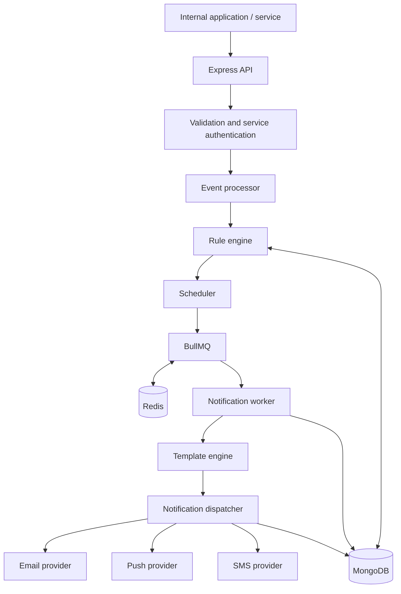

# Event-Driven Notification Service

A TypeScript and Node.js backend for processing application events and delivering asynchronous notifications across email, push, and SMS channels. The service combines rule-based workflows, scheduled jobs, background workers, template rendering, and delivery logging.

## Highlights

- **Event-driven processing** — accept validated events and evaluate notification rules.
- **Asynchronous delivery** — process notification jobs with BullMQ and Redis.
- **Multi-channel dispatch** — integrate email, push, and SMS providers behind a dispatcher layer.
- **Scheduling** — support immediate and delayed notification workflows.
- **Template rendering** — render reusable Handlebars templates with event and user context.
- **Operational visibility** — persist delivery logs and expose health and queue metrics.
- **Security controls** — role-protected administration, service-to-service event authentication, password hashing, rate limiting, and CORS allowlisting.

## Architecture



MongoDB stores notification configuration, templates, delivery logs, admin accounts, device tokens, and idempotency records. Redis backs the BullMQ queues and worker coordination.

## Technology stack

| Area | Technologies |
|---|---|
| Runtime and language | Node.js 20+, TypeScript |
| HTTP API | Express |
| Persistence | MongoDB, Mongoose |
| Background jobs | BullMQ, Redis, ioredis |
| Authentication | JWT, Node.js scrypt password hashing |
| Validation | Joi |
| Templates | Handlebars |
| Integrations | Amazon SES, Firebase Cloud Messaging, MSG91 |
| Logging | Pino |
| API documentation | Swagger / OpenAPI |
| Testing | Jest, Supertest |
| Containerization | Docker, Docker Compose |

## Getting started

### Prerequisites

- Node.js 20 or later
- npm
- Docker and Docker Compose
- Git

### 1. Clone and configure

```bash
git clone <repository-url>
cd Notification-Microservice-new-backend
cp .env.example .env
```

Update `.env` with local configuration. Generate unique random values for `JWT_SECRET` and `SERVICE_API_KEY`; do not use the example placeholders outside a disposable local environment.

For local development, set `MONGODB_URI` to the authenticated localhost MongoDB URI shown in `.env.example`, set `REDIS_HOST=localhost`, and configure the provider credentials you intend to exercise. Use URL-safe generated passwords for the MongoDB and Redis credentials.

### 2. Start MongoDB and Redis

```bash
docker compose up -d mongo redis
```

### 3. Install dependencies and seed development data

```bash
npm ci
npm run seed
```

The seed command creates the initial administrator and sample notification configuration/templates. Set `SEED_ADMIN_EMAIL` and `SEED_ADMIN_PASSWORD` in `.env` first. The password must be at least 12 characters; no default administrator password is shipped.

### 4. Start the API

```bash
npm run dev
```

The API listens on the configured port (default `3000`). Swagger documentation is available at `/docs`.

### Run the containerized service

Set production-quality values for `JWT_SECRET`, `SERVICE_API_KEY`, and `CORS_ORIGINS` in the environment, then run:

```bash
docker compose up --build -d
```

## API overview

| Area | Endpoint | Purpose |
|---|---|---|
| Authentication | `POST /api/auth/login` | Authenticate an administrator |
| Authentication | `GET /api/auth/me` | Get the authenticated administrator |
| Events | `POST /api/events/emit` | Accept an event for asynchronous processing |
| Events | `POST /api/events/emit/sync` | Submit an event and wait for processing |
| Devices | `POST /api/devices/register` | Register a push-notification device |
| Devices | `DELETE /api/devices/:token` | Deregister a device |
| Administration | `/api/admin/configs` | Manage notification rules |
| Administration | `/api/admin/templates` | Manage notification templates |
| Operations | `/api/admin/logs` | Inspect delivery logs |
| Operations | `/api/admin/metrics` | Inspect notification metrics |
| Operations | `/api/admin/metrics/queue` | Inspect queue metrics |

The full request and response schemas are documented in the Swagger UI at `/docs`.

### Event ingestion example

Event-ingestion requests must include the configured service key in the `x-service-key` header whenever `SERVICE_API_KEY` is set. Production startup requires this key.

```bash
curl -X POST http://localhost:3000/api/events/emit \
  -H "Content-Type: application/json" \
  -H "x-service-key: <SERVICE_API_KEY>" \
  -d '{
    "event": "USER_SIGNED_UP",
    "userId": "user_123",
    "timestamp": "2026-11-24T10:00:00.000Z"
  }'
```

## Security

- Administrator passwords are stored using Node.js scrypt with a per-password random salt.
- Existing SHA-256 password records are upgraded to scrypt after a successful login.
- JWT-protected administration routes enforce role-based access for write operations.
- Event ingestion uses a service API key in production.
- The Bull Board queue dashboard is protected by dedicated HTTP Basic Auth credentials; production startup requires both credentials and a strong password.
- Production CORS uses an explicit origin allowlist; configure `CORS_ORIGINS` for browser clients. Development permits origins when no allowlist is configured.
- Docker Compose protects MongoDB and Redis with credentials and binds their host ports to loopback interfaces. Redis uses `noeviction` so queue keys are not silently evicted under memory pressure.
- Login and event-ingestion endpoints are rate-limited. Endpoints with request schemas validate payloads, and Helmet sets security headers.
- Production startup validates JWT, service API, queue-dashboard, MongoDB, Redis, and CORS configuration before accepting traffic.
- Initial administrator credentials are supplied through environment variables and are never printed to logs.
- Existing deployments must rotate or disable administrator accounts created by older seed scripts; updating the seeder does not change credentials already stored in MongoDB.

## Reliability and operations

- BullMQ provides asynchronous job execution and configurable retry/backoff behavior.
- Idempotency records help detect notifications that have already been processed. A failed idempotency lookup fails the job instead of silently allowing a send.
- Delivery logs record successful, failed, and skipped notification attempts.
- `/health` and `/ready` expose service health information.
- Pino provides structured application and worker logs.

**Delivery semantics:** queue retries and external provider calls can produce at-least-once behavior. The current check-then-send-then-mark idempotency flow is not an atomic exactly-once guarantee; provider-side idempotency or an atomic reservation/claim workflow is needed before making that guarantee.

## Development commands

| Command | Description |
|---|---|
| `npm run dev` | Start the API with development reload |
| `npm run build` | Compile TypeScript into `dist/` |
| `npm start` | Start the compiled service |
| `npm run typecheck` | Run the TypeScript compiler without emitting files |
| `npm run lint` | Run ESLint against TypeScript source files |
| `npm test` | Run the Jest test suite |
| `npm run test:unit` | Run unit tests |
| `npm run test:integration` | Run integration tests (MongoDB and Redis required) |
| `npm run seed` | Seed the administrator and sample notification data |

Integration tests use a process-specific test database and remove that test database during teardown. Do not change the integration test database to a shared or production database.

## Continuous integration

The GitHub Actions workflow installs dependencies with `npm ci`, runs TypeScript typechecking and the production build, and executes the Jest suite against MongoDB and Redis service containers.

## Project structure

```text
src/
├── config/          # Application, database, Redis and Swagger configuration
├── controllers/     # HTTP request handlers
├── dispatchers/     # Notification channel orchestration
├── events/          # Event processing
├── integrations/    # External provider integrations
├── middleware/      # Authentication, validation and error handling
├── models/          # Mongoose schemas
├── monitoring/      # Health checks and scheduled jobs
├── queue/           # BullMQ queue management
├── routes/          # Express routes
├── rule-engine/     # Notification rule evaluation
├── scheduler/       # Job scheduling
├── services/        # Idempotency, logging and user context
├── templates/       # Handlebars template rendering
├── utils/           # Shared utilities and structured logging
├── validators/      # Request validation schemas
└── workers/         # Background notification workers

tests/
├── unit/
└── integration/
```

## Configuration

See [`.env.example`](.env.example) for the complete environment-variable template. Never commit a populated `.env`, real provider credentials, production tokens, or private keys.
